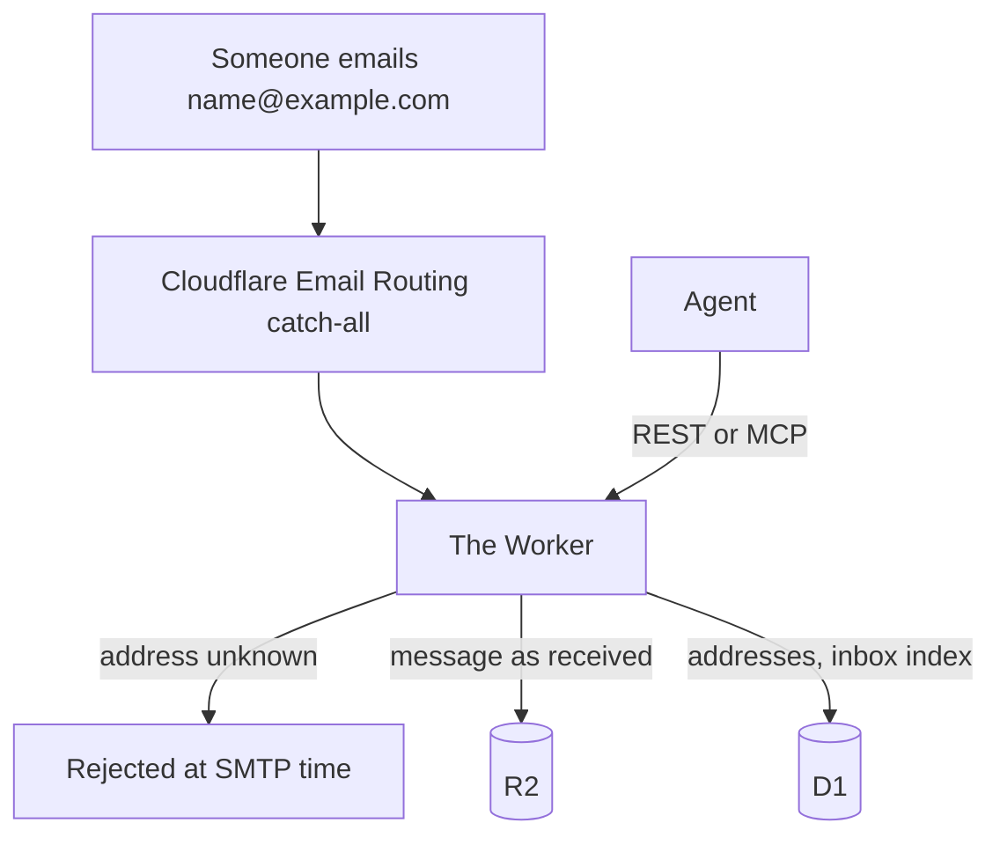

# InboxProbe

Let your coding agent test the whole signup flow, including the email.

InboxProbe gives AI agents and test suites real, throwaway inboxes on your own domain, running on one
Cloudflare Worker. The agent makes an address like `signup-test@example.com`, signs up with it, and
waits: the verification link and the one-time code come back in a single call. When the test is done,
it deletes the address.

It covers any flow that ends in an email: signups and verification, password resets, magic links,
one-time codes, invites and receipts.

- **A REST API** for making addresses and reading mail.
- **An MCP server**, so Claude Code, Cursor or any MCP client can make an inbox and wait for mail
  with no code.
- **Links and codes pulled out** of each message, so an agent can click the verification link or
  type the code without parsing HTML.
- **A calendar for every address** over CalDAV. Invites mailed to the address land in it, and an
  iPhone can sync it.
- **No servers to run.** Mail comes in through Cloudflare Email Routing, addresses and the inbox
  index live in D1, and each message is kept as received in R2.

It receives mail only. It doesn't send yet (see [Not yet](#not-yet)).

## How it works



Every message for your domain goes to the Worker. If the address exists, the Worker keeps the message
in R2 and indexes it in D1; if not, it rejects the message so the sender gets a bounce. Agents read
mail back over the REST API or the MCP server.

Tokens are stored only as hashes, so a leaked database doesn't leak access to inboxes.

## What you need

- A Cloudflare account.
- A domain whose DNS is on Cloudflare. A domain used only for this is best, because the Worker takes
  every message sent to it.
- Node.js 20 or later.

Email Routing and D1 are free. R2 is free up to 10 GB, but you have to accept its free plan in the
Cloudflare dashboard once before you can create a bucket.

## Deploy your own

**1. Clone and install.**

```sh
git clone https://github.com/jerrickhakim/inboxprobe.git
cd inboxprobe
npm install
npx wrangler login
```

**2. Make the database and the bucket.**

```sh
npx wrangler d1 create inboxprobe
npx wrangler r2 bucket create inboxprobe-mail
```

**3. Configure the Worker.** Fill in the `<…>` values in `wrangler.jsonc`:

- `vars.DOMAIN`: your domain (`example.com`). Addresses are `name@DOMAIN`. The domain lives only
  here, never in the code; the Worker refuses to run without it.
- `database_id`: what `wrangler d1 create` printed.
- `routes`: a hostname on your domain for the API, MCP server and calendar (`dav.example.com`), or
  remove `routes` to use only the `workers.dev` address.

If you named the database, bucket or Worker differently in step 2, change those names too.

**4. Set the secrets.** `ADMIN_TOKEN` guards creating addresses and the admin routes. Without it,
no one can create an address.

```sh
openssl rand -base64 32 | npx wrangler secret put ADMIN_TOKEN
```

Keep a copy of the value: you'll pass it as the Bearer token when creating inboxes.

**5. Create the tables and deploy.**

```sh
npm run db:migrate
npm run deploy
```

**6. Turn on Email Routing.** In the Cloudflare dashboard, open your domain → **Email** → **Email
Routing** and enable it. Cloudflare adds the MX, SPF and DKIM records. Then, under **Routing rules**,
set the **catch-all** action to **Send to a Worker** and choose your Worker.

**7. Check it.** Make an address, send it a real email from any mail account, and read it back:

```sh
URL=https://inboxprobe.<your-subdomain>.workers.dev
curl -s -X POST $URL/accounts -H "authorization: Bearer $ADMIN_TOKEN" -d '{"name":"hello"}'
# → {"id":"…","address":"hello@example.com","token":"mt_…"}

curl -s "$URL/messages" -H "authorization: Bearer mt_…"
```

Mail usually arrives within a few seconds. If it doesn't, see [Troubleshooting](#troubleshooting).

## Use it from an agent

### MCP

Add the Worker's `/mcp` endpoint to any MCP client. For Claude Code:

```sh
claude mcp add --transport http inboxprobe https://dav.example.com/mcp
```

| Tool | Input | Answer |
| --- | --- | --- |
| `create_inbox` | `name?` | `address` and `token` (shown once) |
| `check_mail` | `token`, `message_id?`, `wait_seconds?` (max 50), `subject?`, `from?` | The oldest unread match in full, with its `links` and `codes`, marked read, plus the newest 10 messages |
| `delete_inbox` | `token` | `deleted` |

`check_mail` with `wait_seconds` holds the request open until mail arrives, so an agent can sign up
for something and wait for the email in one call.

The MCP server is public: anyone who can reach it can create inboxes, without the admin token. It's
switched on by the `MCP_CREATE` rate limit binding in `wrangler.jsonc`, which caps inbox creation at
10 a minute per IP. Remove that binding to turn `/mcp` off.

It speaks Streamable HTTP without sessions: each POST gets a JSON answer, with no SSE.

### REST

```sh
# Make an address (admin token). Leave out the name for a random one.
curl -s -X POST $URL/accounts -H "authorization: Bearer $ADMIN_TOKEN" -d '{"name":"signup-test"}'

# Read it (the address's token).
curl -s "$URL/messages?unread=true" -H "authorization: Bearer $TOKEN"
curl -s "$URL/messages/<id>" -H "authorization: Bearer $TOKEN"

# Delete it and all its mail.
curl -s -X DELETE $URL/account -H "authorization: Bearer $TOKEN"
```

## API

Errors are `{ "error": "…" }`.

### Addresses

Names are 1–64 lowercase letters, digits, `.`, `-` and `_`, starting and ending with a letter or digit.
`postmaster`, `abuse`, `admin` and similar names are reserved. Mail to `name+anything@DOMAIN` goes to
`name`.

| Route | Auth | What |
| --- | --- | --- |
| `POST /accounts` `{ "name"? }` | admin | `201 { id, address, token }`. The token is shown only this once. `409` if the name is taken or reserved, `400` if it breaks the rule. |
| `GET /account` | token | `{ id, address, created_at, messages, unread }` |
| `DELETE /account` | token | Deletes the address and all its mail. Mail sent to it afterwards bounces. |
| `GET /health` | none | `{ ok, domain }` |

### Mail

Every address has the folders INBOX, Sent, Drafts, Archive, Junk and Trash. New mail goes to INBOX.

| Route | What |
| --- | --- |
| `GET /mailboxes` | `{ mailboxes: [{ name, special_use, messages, unread }] }` |
| `GET /messages?mailbox&limit&unread&before` | Newest first, from INBOX unless `mailbox` says otherwise: `{ messages: [{ id, from, to, subject, snippet, size, attachments, received_at, read }], next }`. Pass `next` as `before` for the next page. |
| `GET /messages/:id` | The parsed message: `text`, `html`, `to`, `cc`, `reply_to`, `message_id`, `in_reply_to` and `attachments`. Marks it read. |
| `GET /messages/:id/raw` | The message exactly as received (`message/rfc822`). |
| `GET /messages/:id/attachments/:index` | One attachment's bytes. |
| `POST /messages/:id/move` `{ "mailbox" }` | Moves it. It comes back under a new id. |
| `DELETE /messages/:id` | Deletes it for good. |

All of these take the address's token as `Authorization: Bearer <token>`.

### Admin

These take `ADMIN_TOKEN` and see every inbox at once. Reading through them never marks mail as read,
so an agent waiting for unread mail still gets it.

| Route | What |
| --- | --- |
| `GET /admin/accounts?limit` | Every address with its counts and latest mail, latest first |
| `DELETE /admin/accounts/:id` | Deletes an address and its mail |
| `GET /admin/messages?account&mailbox&q&unread&limit&before` | Mail across every inbox, or one `account`. `q` searches subject, from, to and snippet. |
| `GET /admin/messages/:id` (`/raw`, `/attachments/:n`) | One message |
| `DELETE /admin/messages/:id` | Deletes a message |

### App passwords

For signing in to the calendar from a phone. They work for CalDAV only, never the REST API.

| Route | What |
| --- | --- |
| `GET /app-passwords` | `{ app_passwords: [{ id, name, created_at, last_used_at }] }` |
| `POST /app-passwords` `{ "name" }` | `201 { id, name, password }`. Shown only once. |
| `DELETE /app-passwords/:id` | Revokes it |

## Calendar

Every address has one calendar over CalDAV at `/dav/`. The username is the address; the password is an
app password or the address's token.

**On an iPhone,** open `https://<your host>/setup.mobileconfig?address=name@example.com` in Safari,
install the profile from Settings, and paste an app password when asked. The profile holds no secret.
To add it by hand, go to Settings → Apps → Calendar → Calendar Accounts → Add Account → Other → Add
CalDAV Account. Add it from Calendar's settings, not Mail's: iOS leaves a CalDAV account added under
Mail inactive.

**Invites** mailed to the address (from Google, Outlook or iCloud) are filed into the calendar.
`REQUEST` and `PUBLISH` add or update the event, and `CANCEL` removes it. Nothing is sent back.

| Route | What |
| --- | --- |
| `GET /events?from&limit` | Upcoming events, soonest first |
| `GET /events/:id` | One event as iCalendar |
| `GET /setup.mobileconfig?address=` | The iOS profile |
| `/dav/…` | CalDAV: `PROPFIND`, `PROPPATCH`, `REPORT` (`calendar-multiget`, `calendar-query`, `sync-collection`) and `GET`/`PUT`/`DELETE` on events |

## Develop

```sh
npm install
cp .dev.vars.example .dev.vars     # sets a local ADMIN_TOKEN
npm run db:migrate:local
npm run dev                        # http://localhost:8787
```

Send a test email into the local Worker:

```sh
curl -X POST "localhost:8787/cdn-cgi/handler/email?from=sam@gmail.com&to=hello@example.com" \
  --data-binary $'From: sam@gmail.com\r\nTo: hello@example.com\r\nSubject: Hi\r\n\r\nHello'
```

`npm test` runs the tests inside the Workers runtime, and `npm run typecheck` checks the types. When
you add a migration, run it locally and with `npm run db:migrate` before deploying.

| File | What |
| --- | --- |
| `src/index.ts` | The routes: addresses, mail, admin |
| `src/receive.ts` | Taking mail from Email Routing |
| `src/mail.ts` | Every change to a mailbox |
| `src/mcp.ts` | The MCP server, and pulling links and codes out of messages |
| `src/calendar.ts` | CalDAV and invites |
| `migrations/` | The D1 schema |

## Troubleshooting

- **Bounce "550 5.1.1 Address does not exist":** Cloudflare rejected it, so the catch-all didn't reach
  the Worker. Check the catch-all rule. If you just set it, wait a minute and send again.
- **Bounce "No such address here.":** the Worker rejected it because no address has that name.
  Create it first.
- **Nothing arrives:** check that `dig MX example.com` points at `route*.mx.cloudflare.net`, and look
  for a bounce in the sender's inbox. `npx wrangler tail` shows the Worker's logs live.
- **"Please enable R2 through the Cloudflare Dashboard":** accept R2's free plan in the dashboard,
  then create the bucket again.

## Not yet

- **Sending mail.** Addresses can only receive. Sending would go through Cloudflare Email Sending or a
  relay such as SES.
- **Webhooks**, so an agent hears about new mail without polling.
- **IMAP and SMTP** for desktop and phone mail apps.
- **Calendar scheduling** (sending invites and replies) and expanding repeating events in
  `calendar-query`.

## License

[MIT](LICENSE)
